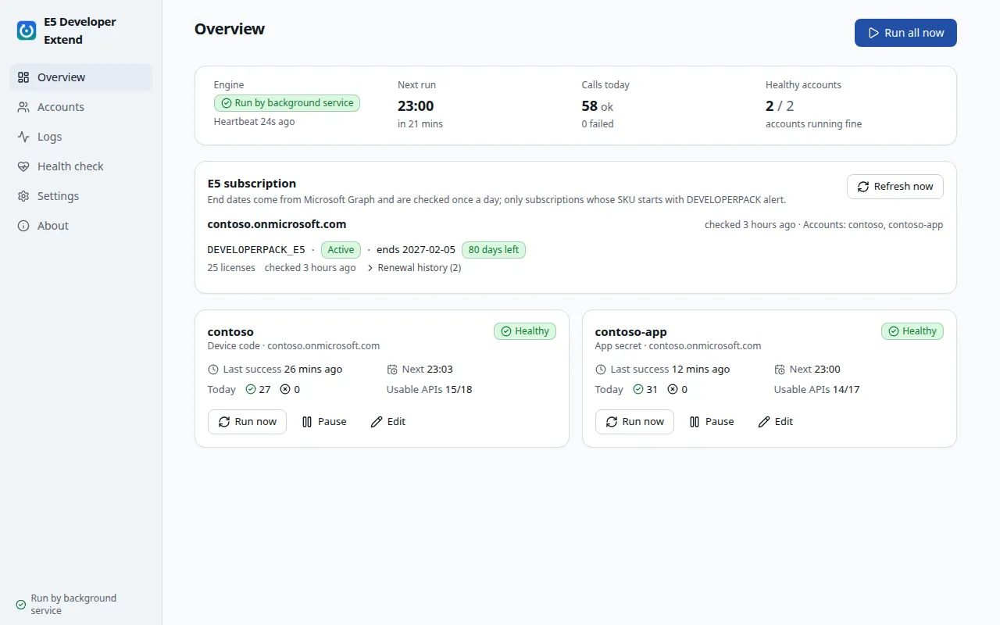
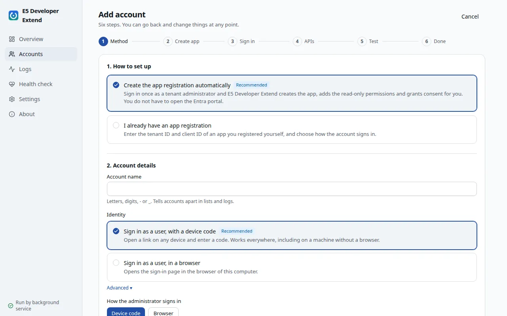
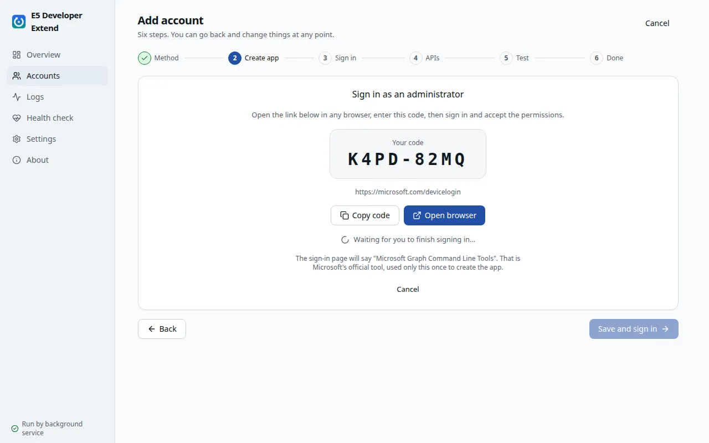
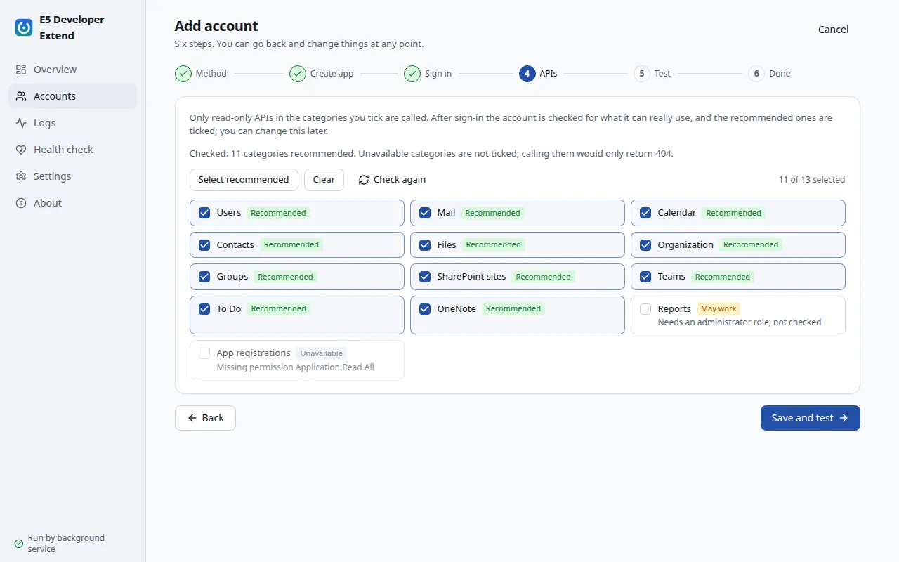

# E5 Developer Extend

**English** | [简体中文](README.zh-CN.md)

**Keep your Microsoft 365 E5 developer tenant active.**

[](https://github.com/KKazuhaK/e5-developer-extend/releases/latest)
[](LICENSE)

E5 Developer Extend calls read-only Microsoft Graph APIs on a randomized schedule so that your Microsoft 365 E5
developer tenant keeps seeing development activity. It runs on **Windows, macOS and Linux**, as a **desktop app**
(the easy way) or as a **command-line program** for servers, and it is built to run in the background for a long time.



> **Please read first**
>
> - Microsoft does not publish how it decides to renew a developer subscription. This tool **cannot guarantee** a
>   renewal; it only gives the tenant regular, natural-looking activity and tells you what happened.
> - It only **reads**: it never writes, sends or deletes anything, and response bodies are not stored.
> - It is not affiliated with Microsoft. Microsoft 365, Microsoft Graph and Entra are trademarks of Microsoft.
> - Nothing is called while the computer is off or asleep. For long-term use, run it on an always-on machine or server.

## Features

- **Automatic app registration**: sign in once as the tenant administrator and the app is created in your tenant with
  read-only permissions and admin consent. No trip to the Entra portal. (Hand-made registrations work too.)
- **API recommendations**: after sign-in, each account is checked for what it can really use (mailbox, OneDrive,
  Teams, SharePoint) and the matching API categories are ticked for you.
- **Subscription expiry tracking**: the end date and status of the E5 subscription, with renewal history and warnings
  30, 7 and 1 days before the end.
- **Alerts**: Telegram, email, WeCom, Feishu, DingTalk, Discord, Slack, Bark, ntfy, ServerChan and generic webhooks,
  with noise control (cooldown, quiet hours) and message templates.
- **Backup and migration**: one encrypted file moves everything to another machine, with no new sign-in.
- **Runs in the background**: start at login, a real background service (systemd / launchd / Windows scheduled task / Docker),
  recovery after network loss or sleep, and a health check (`doctor`) that explains what to fix.
- **Randomized and gentle**: random APIs, order and parameters, working days and hours, several accounts, automatic
  pause after repeated failures. Sign-in by browser, device code or client secret.
- **Small**: the command-line program is about 10 MB, a single executable with no runtime dependencies.

## Quick start: the desktop app

**1. Download and install.** Get the file for your system from the
[latest release](https://github.com/KKazuhaK/e5-developer-extend/releases/latest). The packages are not code-signed yet,
so Windows and macOS ask for one extra click the first time ([how](docs/user/install.md)).

| System | Download (replace `<version>`) |
|---|---|
| Windows 10/11 | `E5-Developer-Extend_<version>_windows_amd64_setup.exe` (ARM: `arm64`) |
| macOS 12+ | `E5-Developer-Extend_<version>_macos_universal.dmg` (Intel and Apple silicon) |
| Ubuntu 24.04+ / Debian 13+ | `e5extend_<version>-1_amd64.deb` **and** `e5extend-desktop_<version>-1_amd64.deb` |
| Fedora 39+ | `e5extend-<version>-1.x86_64.rpm` **and** `e5extend-desktop-<version>-1.x86_64.rpm` |

**2. Open it** from the Start menu, Applications or the app menu: **E5 Developer Extend**.

**3. Add an account.** Go to **Accounts → Add account** and keep **Create the app registration automatically**
(recommended). Give the account a name and choose **Next**.



**4. Sign in as the tenant administrator once.** Open the link, type the code, sign in. The page says
"Microsoft Graph Command Line Tools": that is Microsoft's own tool, used only this one time. Then check the plan and
choose **Confirm and create**.



**5. Pick the APIs and finish.** The account signs in with the new app, then the APIs are suggested with
"Recommended" badges. Accept them, run the test, finish. In **Settings** turn on **Keep running in the background**
and you are done.



The full walk-through, with alerts, backup and the subscription card, is in the
[getting-started guide](docs/user/getting-started.en.md).

## For servers and the command line

No desktop needed. Install the command-line package (or the tar.gz / zip, or the Docker image), then run the wizard:

```bash
e5extend init      # config, account, sign-in, a first run, alerts, background service, health check
```

Or step by step: `config init` → `account add` → `account login` → `run-now` → `service install` → `doctor`.
For Docker: `docker pull ghcr.io/kkazuhak/e5-developer-extend:<version>`, see [docs/user/docker.md](docs/user/docker.md)
(in Chinese). The CLI part of the guide is the last section of the
[getting-started guide](docs/user/getting-started.en.md#command-line-and-servers).

## Documentation

The detailed user documentation is written in **Chinese**; the English
[getting-started guide](docs/user/getting-started.en.md) covers the same path from install to alerts.

| Document | Contents |
|---|---|
| [docs/user/getting-started.en.md](docs/user/getting-started.en.md) | Getting started, GUI first (English) |
| [docs/user/getting-started.md](docs/user/getting-started.md) | Getting started (Chinese) |
| [docs/user/install.md](docs/user/install.md) | Download and install on each system, upgrade, uninstall |
| [docs/user/app-registration.md](docs/user/app-registration.md) | Entra app registration, automatic or by hand |
| [docs/user/background.md](docs/user/background.md) | Running in the background: Linux, macOS, Windows, Docker |
| [docs/user/docker.md](docs/user/docker.md) | Docker and compose |
| [docs/user/backup.md](docs/user/backup.md) | Backup and migration |
| [docs/user/notifications.md](docs/user/notifications.md) | Alert channels, noise control, templates |
| [docs/user/faq.md](docs/user/faq.md) | FAQ |
| [docs/user/troubleshooting.md](docs/user/troubleshooting.md) | Troubleshooting by `doctor` check |
| [docs/architecture.md](docs/architecture.md), [docs/research.md](docs/research.md), [docs/dev-setup.md](docs/dev-setup.md) | Design and development (Chinese) |
| [CHANGELOG.md](CHANGELOG.md) | What changed (Chinese) |

## Build from source

Go 1.26 or newer. The command-line program:

```bash
go build -o bin/e5extend ./cmd/e5extend
./bin/e5extend version
```

The desktop app (Wails v3, React and TypeScript in `gui/frontend`) and the screenshot script are described in
[docs/dev-setup.md](docs/dev-setup.md) and [scripts/screenshots/README.md](scripts/screenshots/README.md).

## License

[MIT](LICENSE)
