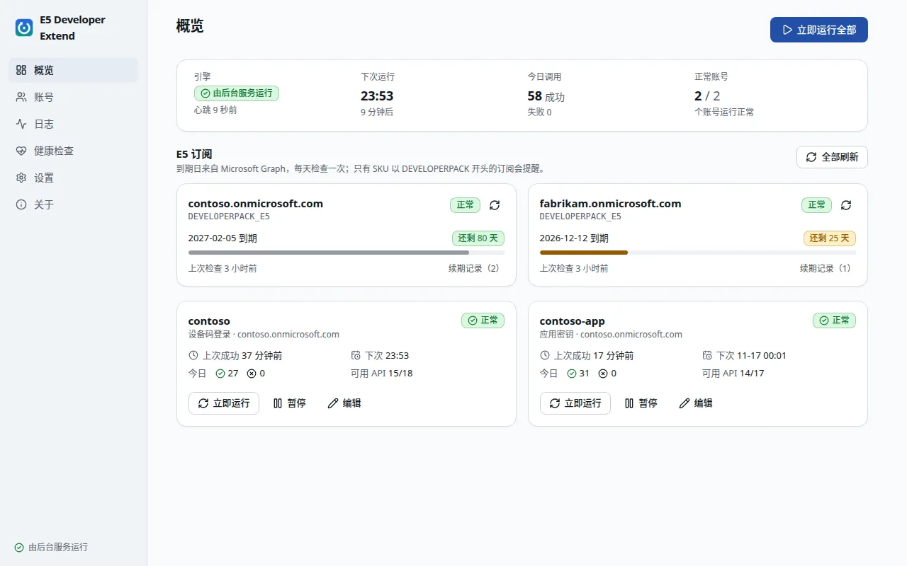
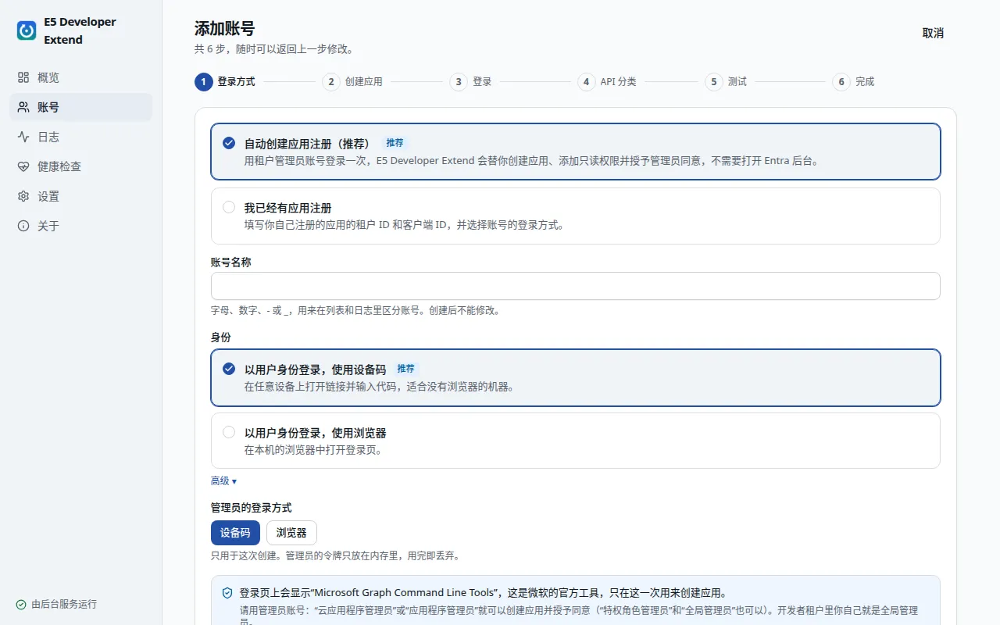
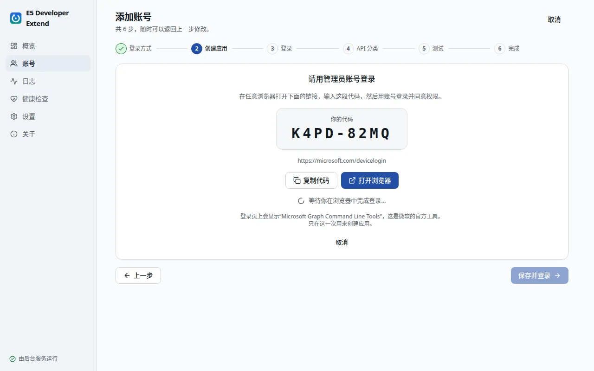
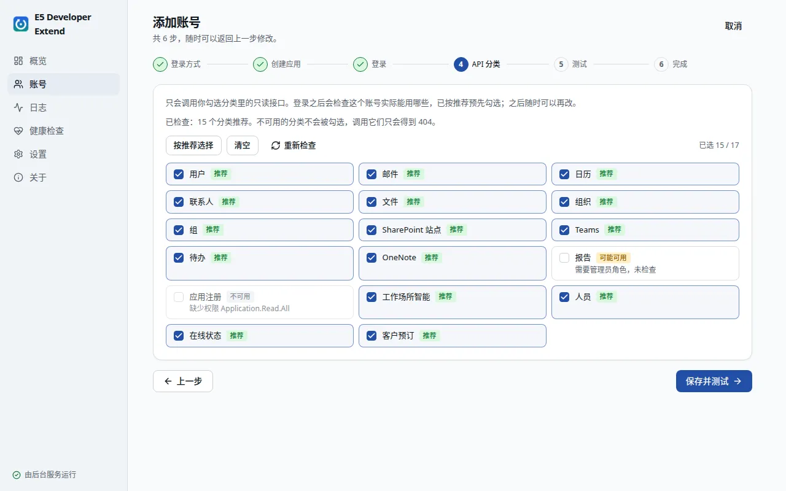

# E5 Developer Extend

[English](README.md) | **简体中文**

**让 Microsoft 365 E5 开发者租户保持活跃。**

[](https://github.com/KKazuhaK/e5-developer-extend/releases/latest)
[](LICENSE)

E5 Developer Extend 按随机的节奏调用 Microsoft Graph 的只读接口，让 Microsoft 365 E5 开发者租户一直有开发活动。
支持 **Windows、macOS、Linux**，有**桌面版**（上手最简单）和给服务器用的**命令行版**，设计目标是**长期在后台稳定运行**。



> **请先看这几句**
>
> - 微软没有公开开发者订阅续期的判定标准。本工具**不保证**订阅一定能续期，它只让租户有规律的、看起来自然的开发活动，并告诉你结果。
> - 微软会在 2026-11-04 退役 Legacy 沙盒开发者订阅：它们还有最后一次 60 天的续期，之后既不能续期也不能转换。请到开发者控制台确认自己的订阅；任何工具都改变不了这件事，详见[常见问题](docs/user/faq.md)。
> - 只做**读取**：不写入、不发送、不删除任何数据，响应内容也不会被保存。
> - 本项目与 Microsoft 没有关联。Microsoft 365、Microsoft Graph、Entra 是 Microsoft 的商标。
> - 电脑关机或睡眠期间不会发出调用。要长期使用，建议放在常开的机器或服务器上。

## 功能

- **自动创建应用注册**：用租户管理员账号登录一次，程序就在你的租户里建好应用、加好只读权限并授予管理员同意，不用打开 Entra 后台。手工建的应用也能用。
- **API 推荐**：登录后检查账号实际能用什么（邮箱、OneDrive、Teams、SharePoint），自动勾选合适的 API 分类。
- **订阅到期追踪**：E5 订阅的到期日和状态、续期记录，到期前 30、7、1 天提醒。
- **告警**：Telegram、邮件、企业微信、飞书、钉钉、Discord、Slack、Bark、ntfy、Server 酱和通用 Webhook；有降噪（冷却、免打扰时段）和消息模板。
- **备份与迁移**：一个加密文件搬到另一台机器，不用重新登录。
- **长期后台运行**：开机自启、真正的后台服务（systemd / launchd / Windows 计划任务 / Docker）、断网和睡眠唤醒后自动恢复，
  还有体检（`doctor`）告诉你哪里要修。
- **随机而克制**：随机接口、顺序和参数，工作日和工作时段，多账号，连续失败自动暂停；登录方式有浏览器、设备码、Client Secret。
- **体积小**：命令行程序约 10 MB，单个可执行文件，无运行时依赖。

## 快速开始：桌面版

**1. 下载并安装。** 从[最新版本](https://github.com/KKazuhaK/e5-developer-extend/releases/latest)下载对应系统的文件。
安装包暂时没有代码签名，Windows 和 macOS 第一次打开时要多点一下（[怎么点](docs/user/install.md)）。

| 系统 | 下载（把 `<版本>` 换成版本号） |
|---|---|
| Windows 10/11 | `E5-Developer-Extend_<版本>_windows_amd64_setup.exe`（ARM 电脑选 `arm64`） |
| macOS 12+ | `E5-Developer-Extend_<版本>_macos_universal.dmg`（Intel 和 Apple 芯片通用） |
| Ubuntu 24.04+ / Debian 13+ | `e5extend_<版本>-1_amd64.deb` **和** `e5extend-desktop_<版本>-1_amd64.deb` |
| Fedora 39+ | `e5extend-<版本>-1.x86_64.rpm` **和** `e5extend-desktop-<版本>-1.x86_64.rpm` |

**2. 打开。** 从开始菜单、应用程序或应用菜单打开 **E5 Developer Extend**。

**3. 添加账号。** 进入**账号 → 添加账号**，保持选中**自动创建应用注册（推荐）**，填一个账号名，点**下一步**。



**4. 用租户管理员登录一次。** 打开链接、输入代码、登录。登录页会显示“Microsoft Graph Command Line Tools”，
这是微软的官方工具，只在这一次用来创建应用。然后看一眼计划，点**确认并创建**。



**5. 选 API，完成。** 账号会用新建的应用登录，然后给出带“推荐”标记的 API 分类。接受推荐、跑一次测试、完成。
在**设置**里打开**在后台保持运行**就都好了。



带告警、备份和订阅卡片的完整流程见[入门指南](docs/user/getting-started.md)。

## 服务器和命令行

不需要桌面环境。装好命令行包（或 tar.gz / zip、Docker 镜像）后运行向导：

```bash
e5extend init      # 配置、账号、登录、试跑、告警、后台服务、体检
```

或者分步：`config init` → `account add` → `account login` → `run-now` → `service install` → `doctor`。
Docker：`docker pull ghcr.io/kkazuhak/e5-developer-extend:<版本>`，详见 [docs/user/docker.md](docs/user/docker.md)。
命令行的完整步骤是[入门指南](docs/user/getting-started.md#命令行和服务器)的最后一节。

## 文档

| 文档 | 内容 |
|---|---|
| [docs/user/getting-started.md](docs/user/getting-started.md) | 入门指南，桌面版优先（英文版：[getting-started.en.md](docs/user/getting-started.en.md)） |
| [docs/user/install.md](docs/user/install.md) | 下载和安装（各平台、升级、卸载） |
| [docs/user/app-registration.md](docs/user/app-registration.md) | Entra 应用注册（自动创建或手动） |
| [docs/user/background.md](docs/user/background.md) | 各平台后台运行：Linux、macOS、Windows、Docker |
| [docs/user/docker.md](docs/user/docker.md) | Docker 和 compose |
| [docs/user/backup.md](docs/user/backup.md) | 备份与迁移：用一个文件搬到另一台机器 |
| [docs/user/notifications.md](docs/user/notifications.md) | 通知渠道的设置方法，降噪与自定义模板 |
| [docs/user/faq.md](docs/user/faq.md) | 常见问题 |
| [docs/user/troubleshooting.md](docs/user/troubleshooting.md) | 按 `doctor` 检查项排错 |
| [docs/research.md](docs/research.md) | 技术选型与决定 |
| [docs/architecture.md](docs/architecture.md) | 架构、模块、长期后台运行设计 |
| [docs/graph-api-catalog.md](docs/graph-api-catalog.md) | Graph API 库与权限（只读部分已对照官方文档核实，部分条目待实测） |
| [docs/dev-setup.md](docs/dev-setup.md) | 开发环境搭建 |
| [CHANGELOG.md](CHANGELOG.md) | 变更记录 |

## 从源码构建

需要 Go 1.26 或更新版本。命令行程序：

```bash
go build -o bin/e5extend ./cmd/e5extend
./bin/e5extend version
```

桌面版（Wails v3，前端是 `gui/frontend` 里的 React + TypeScript）和截图脚本见 [docs/dev-setup.md](docs/dev-setup.md)、
[scripts/screenshots/README.md](scripts/screenshots/README.md)。

## 许可证

[MIT](LICENSE)
