# Getting started

This guide takes you from installing to a setup that keeps running in the background. It is **desktop-app first**,
with a screenshot for every step (the Contoso tenant and accounts in the pictures are made up). If you only use the
command line or a server, jump to [Command line and servers](#command-line-and-servers).

The detailed reference pages (install, app registration, background running, alerts, backup, FAQ) are written in
Chinese; this guide covers the same path in English.

## What it does, and what it cannot promise

E5 Developer Extend calls **read-only** Microsoft Graph APIs (mail list, calendar, file metadata and so on) at random
times in the background, so that your Microsoft 365 E5 developer tenant keeps seeing development activity.

- Microsoft does not publish how it decides to renew, so a renewal is **not guaranteed**.
- Nothing is called while the computer is off or asleep. For long-term use, run it on an always-on machine or server.
- It only reads: nothing is written, sent or deleted, and response bodies are not stored.

## What you need

- An E5 developer tenant and an administrator account that can manage apps in it (in a developer tenant, your own
  account is a Global Administrator).
- You do not need to register an app first: the automatic setup below does it for you. To register one by hand, see
  [app-registration.md](app-registration.md) (Chinese).

## 1. Install

Download from the [latest release](https://github.com/KKazuhaK/e5-developer-extend/releases/latest): `setup.exe` for
Windows, `dmg` for macOS, `deb` or `rpm` for Linux (for the desktop app install **both** packages). Per-system steps and
how to open the unsigned packages the first time are in [install.md](install.md) (Chinese; the README has the file names).

Then open **E5 Developer Extend** from the Start menu, Applications or the app menu.

## 2. Add your first account (automatic app registration)

Choose **Accounts**, then **Add account**. Keep **Create the app registration automatically** (recommended) and give the
account a name (letters, digits, `-` and `_`; it cannot be changed later).

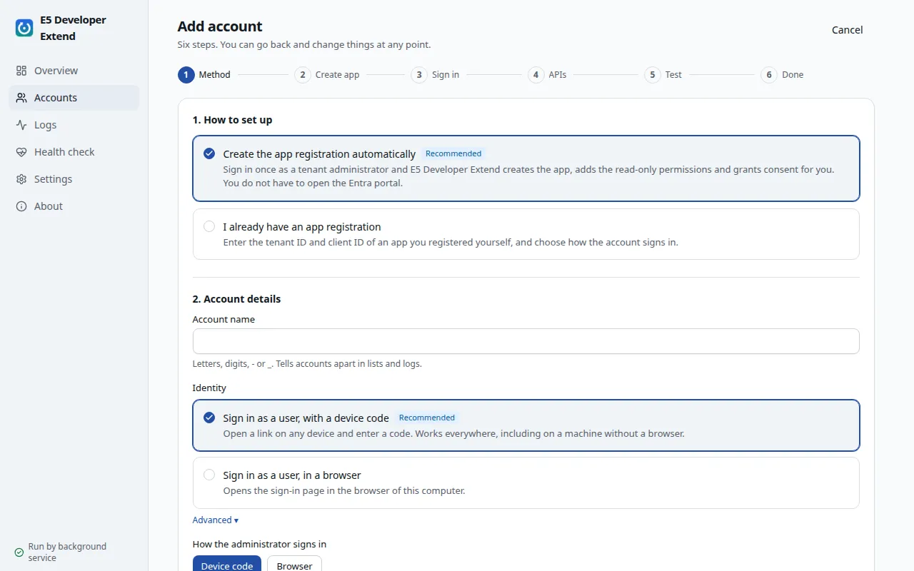

- **Identity**: "Sign in as a user, with a device code" is the default and right for most people. "In a browser" signs
  in in this computer's browser. Under **Advanced** you can pick the **Application identity (client secret)**: nobody
  has to sign in, one user's data is read, and a client secret is created and kept in the encrypted vault, never shown.
  That choice asks for the email of the user to read.
- **How the administrator signs in** (also under Advanced): device code or browser. It is only used for this setup;
  the administrator's token stays in memory and is thrown away afterwards.

Choose **Next**.

### Sign in as the administrator, once

The page shows a code and a link. Open the link in any browser, type the code, and sign in with the tenant
administrator account. **Copy code** and **Open browser** help. The sign-in page says "Microsoft Graph Command Line
Tools": that is Microsoft's own tool, used only this once to create the app.

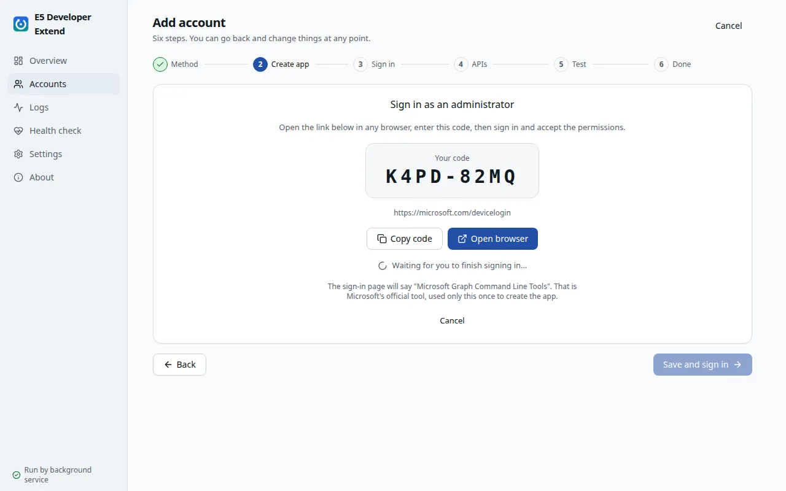

The administrator needs rights to create the app and grant consent: Cloud Application Administrator or Application
Administrator can create it and grant the delegated permissions (Privileged Role Administrator and Global Administrator
can as well).

### Review the plan

After the sign-in the app looks at what already exists in your tenant and lists **what it is going to do**: the app
name, the tenant, the read-only permissions to add, and "What will happen" (create the app, create the service
principal, grant administrator consent, ...). **Nothing is created until you confirm, and nothing that already exists
is removed.**

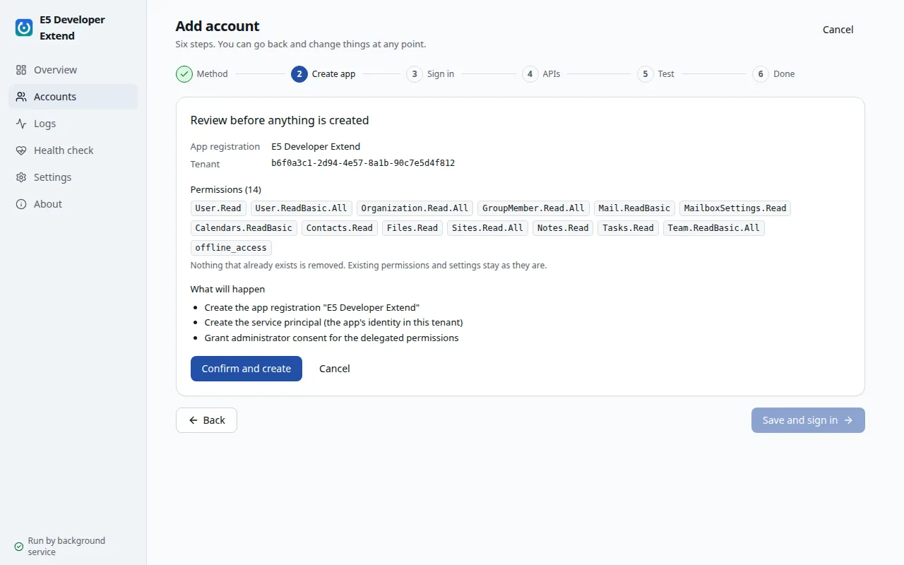

If the tenant already holds an app registration of the same name made by hand, this page lets you **adopt it** or
**create a new one**. Choose **Confirm and create**.

### Progress and result

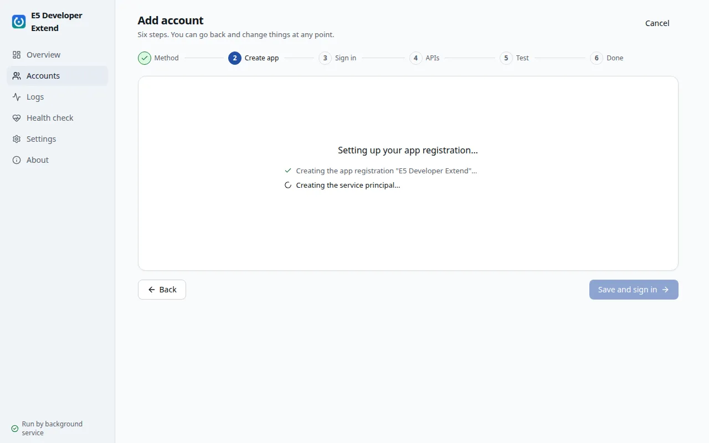

After a few seconds "The app registration is ready" appears with the client ID, the tenant ID and the note that
administrator consent is granted. Choose **Save and sign in** at the bottom right.

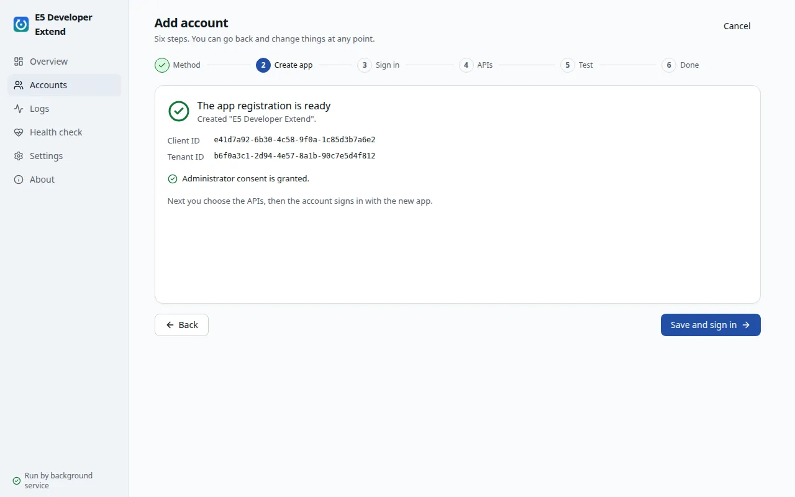

The account now signs in once with the new app (another device code, or a browser window). Microsoft needs a few
seconds to know a brand-new app; the program waits and retries by itself. After "Signed in", choose **Next**.

## 3. Pick the APIs and test

After the sign-in, the account is checked for what it can really use: no Exchange mailbox means no mail, no OneDrive
means no files, and so on. Each category carries a badge: **Recommended** (ticked for you), **Unavailable** (with the
reason, such as "Missing permission Application.Read.All") or **May work** (cannot be confirmed right now). You can
change the ticks; **Select recommended** restores the advice and **Check again** asks again.

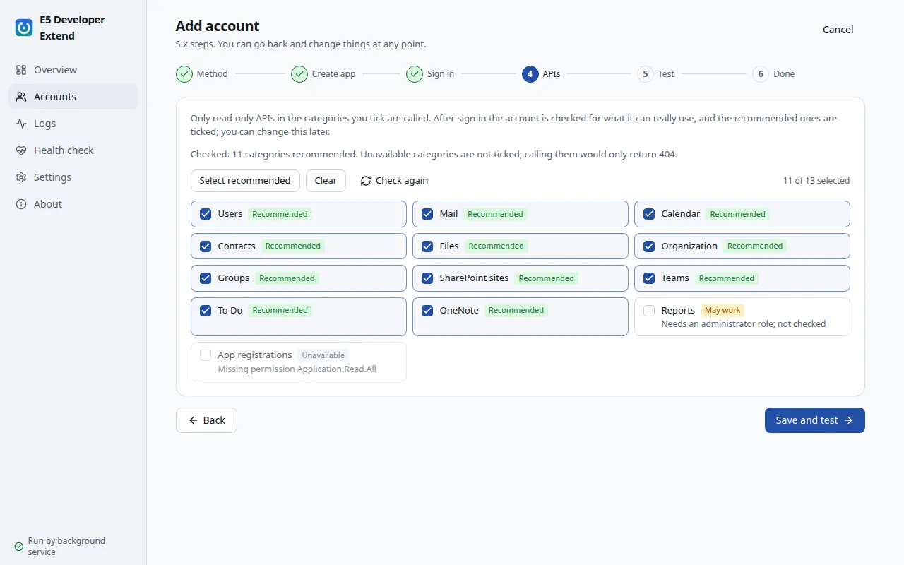

Choose **Save and test**. The test page shows "N of M APIs usable", the granted permissions and the result per
category. Choose **Next**, then **Finish**.

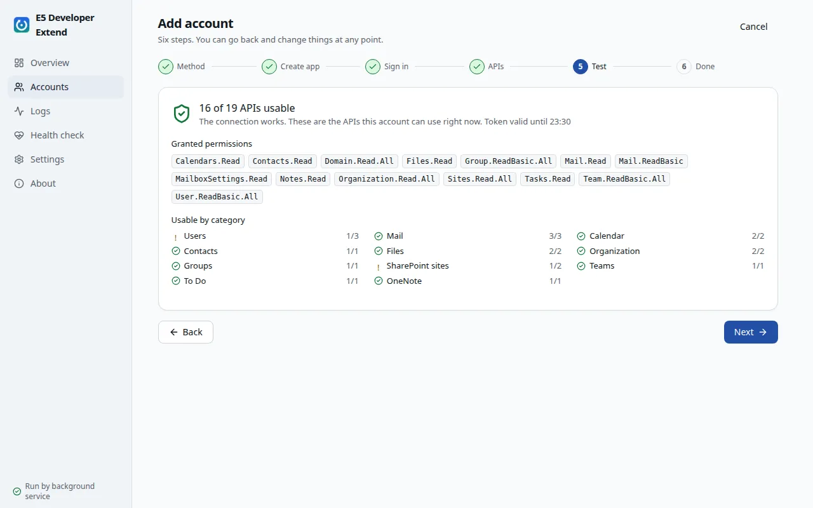

## 4. Check that it is working

The **Overview** page shows the engine state, the next run, today's calls and one card per account. **Run now** runs a
round immediately. The **Accounts** page lists the accounts (pause, edit, sign in again, delete) and **Logs** shows
every call.

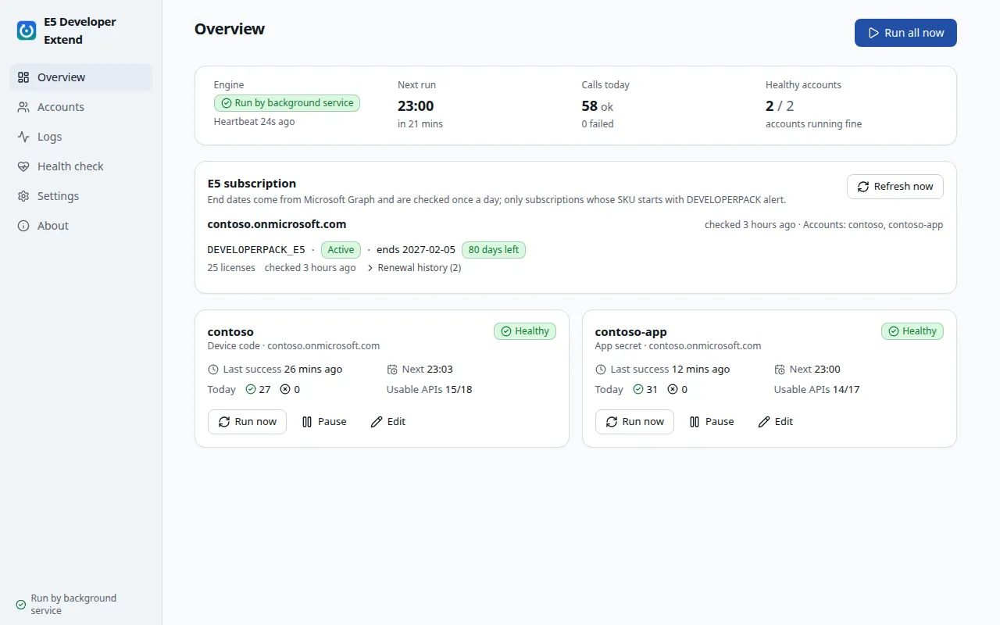

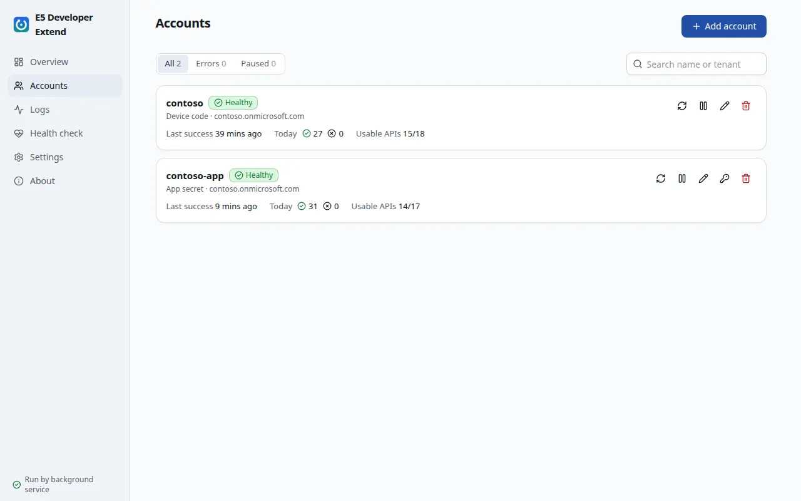

There is a dark theme too (Settings → Interface → Theme):

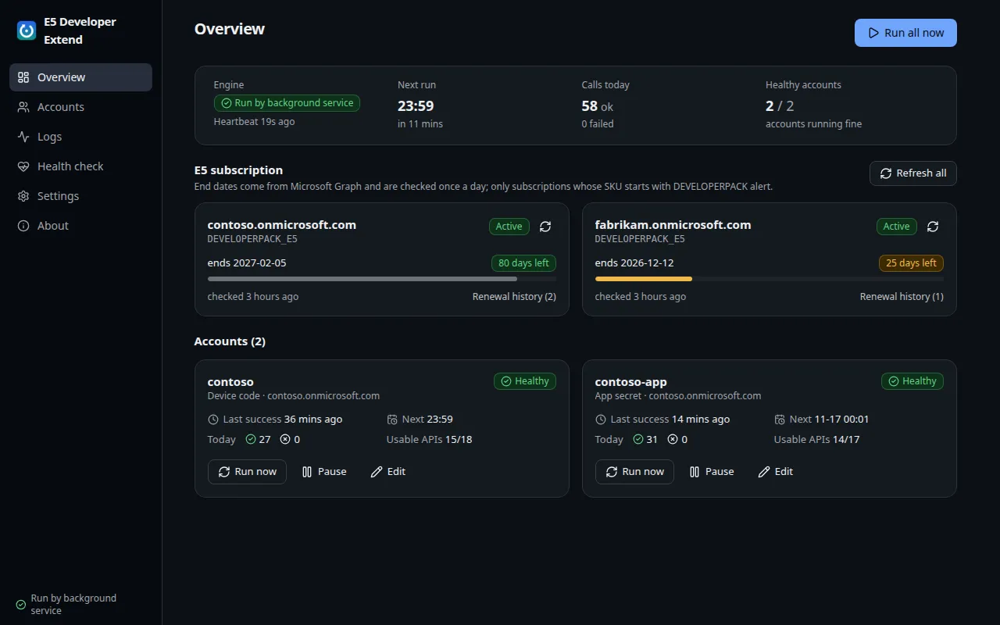

## 5. Keep it running in the background

Open **Settings**. **Running** has two switches:

- **Start tray at login**: starts the tray and the engine when you sign in to the desktop.
- **Keep running in the background**: installs a background service (a systemd user service on Linux, a LaunchAgent on
  macOS, a scheduled task on Windows). Calls continue after you close the window or quit the tray, and no desktop is needed.

When it is on you see "Running" and the next run time. If both exist, the background service runs the engine and the
tray only shows status.

**Call pace** has three presets (Light, Standard, Frequent) and a choice between every day and weekdays only. Exact
intervals, working hours, the active period and a proxy are under **Advanced settings**.

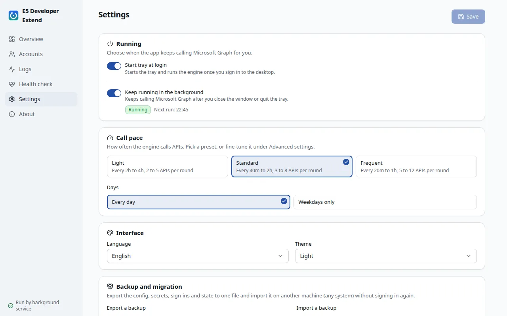

Per-system details are in [background.md](background.md) (Chinese).

## 6. Set up alerts (Telegram as the example)

Get a message on your phone when something is wrong: an account needs to sign in again, calls keep failing, a client
secret is about to expire, the subscription is about to end.

1. **Settings → Advanced settings → Alerts**, then **Add channel**.
2. Choose the type **Telegram**, name the channel (for example `tg`), and enter the **Chat ID** and the **Bot Token**
   (how to get them: [notifications.md](notifications.md#telegram), in Chinese: talk to @BotFather for the token and
   read the chat id from `getUpdates`). The token is never shown again after saving.
3. Save, then choose **Send test**: a message should reach your phone. **Preview** shows what a message looks like first.

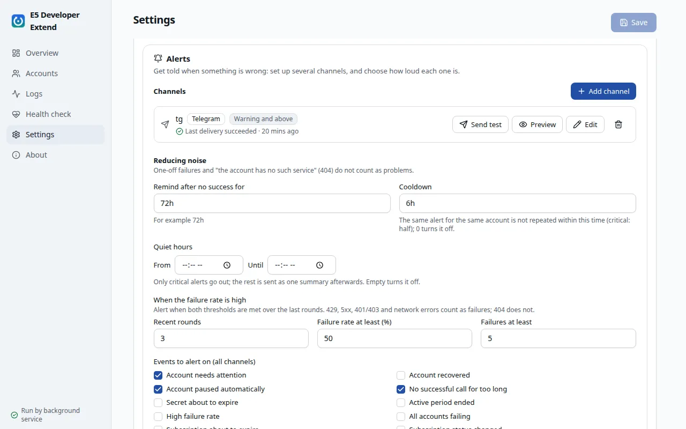

A channel has a minimum level, and further down you can tune noise (cooldown, quiet hours) and the events to alert on.
Email, WeCom, Feishu, DingTalk and the others work the same way.

## 7. Backup and migration

Before changing computers or reinstalling, export one file under **Settings → Backup and migration**: type a backup
passphrase (at least 8 characters, **it cannot be recovered**) twice, decide whether to include the call records, choose
**Export…** and pick where to save. Accounts, secrets, sign-ins and alert settings are inside, encrypted with the passphrase.

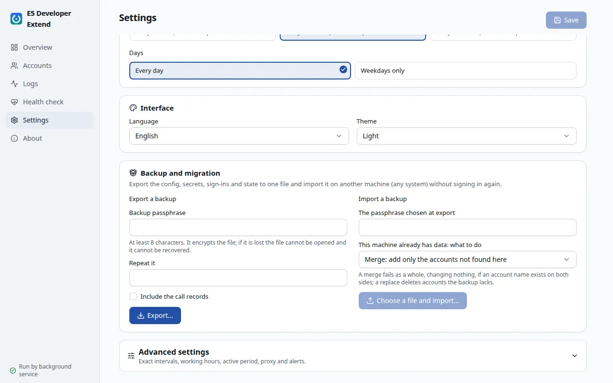

On the new machine type the passphrase in the same place and choose **Choose a file and import…**; if that machine
already has data you can **Merge** or **Replace**. No new sign-in is needed. Details: [backup.md](backup.md) (Chinese).

## Tracking the subscription end date

The **E5 subscription** card on the Overview page shows, per tenant, the SKU (such as `DEVELOPERPACK_E5`), its status,
the end date and the days left. **Renewal history** opens the past renewals and **Refresh now** reads the subscription
again right away. The engine reads it once a day (`GET /directory/subscriptions`), once per tenant.

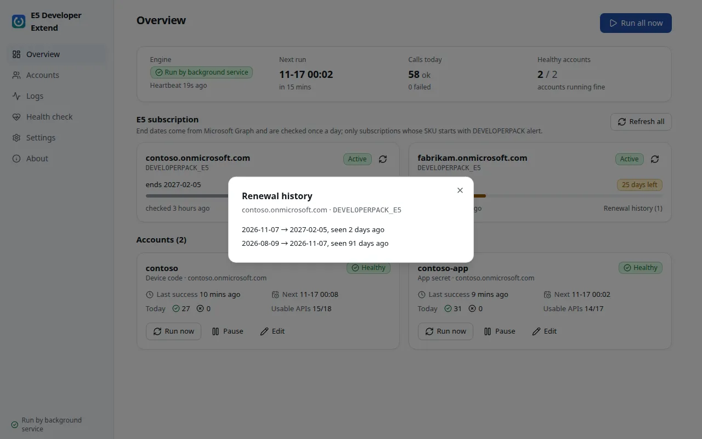

You are warned 30, 7 and 1 days before the end, and told when the status turns bad or a renewal is seen, through the
alert channels you set up. Only subscriptions whose SKU starts with `DEVELOPERPACK` alert; to watch others, set
`[subscription] skus = ["DEVELOPERPACK", "ENTERPRISEPREMIUM"]` in `config.toml` (each entry is a prefix).

This needs the **`Organization.Read.All`** permission with administrator consent; an app made by the automatic setup
already has it. Without it the card says so (this is neither an error nor an alert; it is retried hourly). To add the
missing permission to the app the account **already uses** (no new account, no new client secret):

- Desktop: **Fix permissions** on the card, sign in once as the tenant administrator;
- Command line: `e5extend app setup --repair --account <account>`;
- Or add it by hand under API permissions in Entra and grant consent.

Until then you can type the end date yourself: **Enter the end date yourself** on the card, or
`e5extend subscription <account> --set-expires 2027-02-14`. Real data wins as soon as it can be read.

This only reports facts. Whether Microsoft renews is its own decision; see the [FAQ](faq.md#会不会保证续期) (Chinese).

## Health check

The **Health check** page checks configuration, the vault, the engine, the background service, the network, the clock
and each account's sign-in and permissions, with a suggested fix for anything that is not fine. "Local checks only (no
network)" skips the network checks. When something looks wrong, start here, then see
[troubleshooting.md](troubleshooting.md) and [faq.md](faq.md) (Chinese).

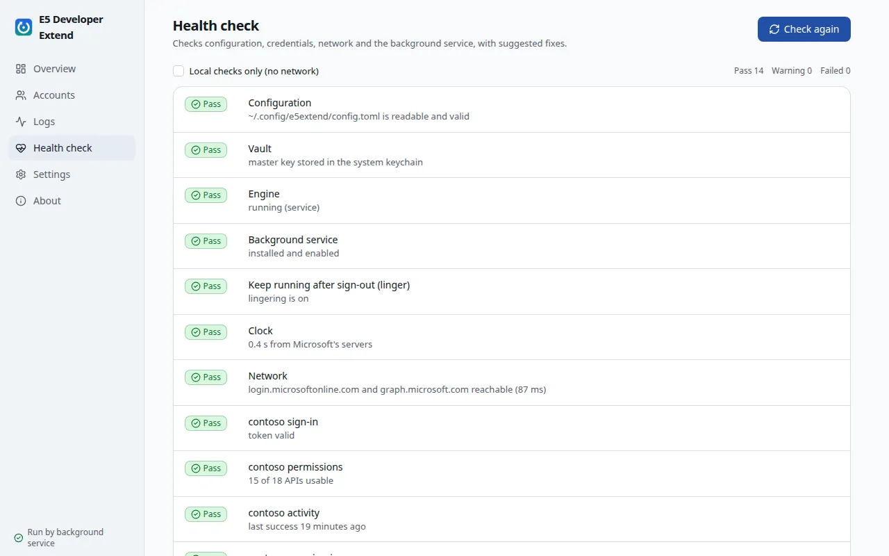

## Command line and servers

For a machine without a desktop, Docker, or if you simply prefer a terminal. The desktop installers already include
the command-line program. For a command-line-only setup, put `e5extend` (on Windows also `e5extend-bg.exe`, the
variant without a console window, in the same folder) in a permanent place such as `~/.local/bin/` or
`C:\Users\you\bin\`. **Not** in a temporary or Downloads folder: the background service refuses to install from there.

### The fastest way: the wizard

```bash
e5extend init
```

Run it in an interactive terminal. Every step can be skipped and finished steps are skipped by themselves:

1. create the default configuration
2. choose where the master key lives (the system keychain; on a server without a desktop choose "generate and show")
3. add an account (choose "create automatically (recommended)" or enter the sign-in method, tenant and client ID of an existing app)
4. sign in
5. fetch a token silently and count the usable APIs
6. run one round now
7. set up a webhook alert (optional)
8. install the background service
9. run `e5extend doctor`

### Step by step

```bash
e5extend config init
e5extend account add main --auto --auth device_code    # create the app and add the account; for an existing app use --tenant and --client-id
e5extend account login main          # open the URL, type the device code
e5extend account test main           # fetch a token silently, list the granted permissions
e5extend run-now main                # one round now, prints each call
e5extend service install             # background service, see background.md
e5extend doctor                      # health check
```

`--auth` is `device_code`, `browser`, `client_secret` or `password`. `client_secret` and `password` prompt for the secret
(not echoed) and keep it in the encrypted vault; the config file holds no secrets. For an existing app:
`e5extend account add main --auth device_code --tenant organizations --client-id <your app id>`.

### Choosing API categories

Not every account has a mailbox, OneDrive or Teams; calling mail, calendar, contacts or to-do without an Exchange
mailbox only returns 404 / 400, round after round. After signing in, ask what the account can use:

```bash
e5extend account test main --recommend            # each category: recommended / unavailable / maybe, with the reason, and the suggested categories
e5extend account test main --recommend --apply    # write the recommended categories to the account (asks first; --yes skips)
```

The check sends a few read-only requests (mailbox settings, OneDrive, Teams, the SharePoint root site) and writes
nothing. `maybe` means it could not be confirmed right now. `--apply` never removes a category because of `maybe`, and
refuses to write while any probe failed (try later, or add `--force`). If the advice equals the default set, the
account's `categories` stays empty so new default categories apply automatically; otherwise an explicit list is
written, which does **not** pick up categories added later: run `--recommend --apply` again after an update.
After a while, if a category returns 404 three rounds in a row, `e5extend doctor` suggests checking again.

### Subscription, status and logs

```bash
e5extend subscription            # read now: SKU, status, end date, days left, trial, renewal history
e5extend subscription --cached   # no network, what the engine saved last
e5extend status        # is the engine running, each account's state, the next run
e5extend logs -n 20    # recent calls
e5extend doctor        # exit code 0 fine, 1 warnings, 2 failures
```

### Alerts and backup

```bash
e5extend notify channel add tg --type telegram --chat-id <your chat id>   # also email, WeCom, Feishu, ...
e5extend notify test
e5extend backup export all.e5backup          # on another machine: backup import
```

Channels and noise control: [notifications.md](notifications.md); backup: [backup.md](backup.md); Docker:
[docker.md](docker.md) (all in Chinese).
