# 入门指南

这份指南带你从安装到让它在后台稳定跑起来，**以桌面版为主**，每一步都有截图（截图里的 Contoso 租户和账号都是虚构的示例）。
只用命令行或服务器的话，直接看最后一节[命令行和服务器](#命令行和服务器)。

## 它能做什么，不能保证什么

E5 Developer Extend 在后台定时、随机地调用 Microsoft Graph 的**只读**接口（读邮件列表、日历、文件信息等），
让 Microsoft 365 E5 开发者租户保持有开发活动。

- 微软没有公开续期的判定标准，**不保证**订阅一定能续期。
- 电脑关机或睡眠期间不会发出调用。长期使用建议放在常开的机器或服务器上。
- 它只读取，不写入、不发送、不删除任何数据；响应内容不会被保存。

## 你需要准备

- 一个 E5 开发者租户，和一个能在租户里管理应用的管理员账号（开发者租户里你自己的账号就是全局管理员）。
- 不需要事先注册应用：下面的“自动创建”会替你完成。想自己注册的话见 [app-registration.md](app-registration.md)。

## 1. 安装

从 [Releases](https://github.com/KKazuhaK/e5-developer-extend/releases/latest) 下载，Windows 选 `setup.exe`，macOS 选 `dmg`，
Linux 选 `deb` 或 `rpm`（桌面版要**两个包都装**）。各系统的详细步骤，以及未签名的包第一次怎么打开，见 [install.md](install.md)。

装好后从开始菜单、应用程序或应用菜单打开 **E5 Developer Extend**。

## 2. 添加第一个账号（自动创建应用）

左边点**账号**，再点**添加账号**。保持选中**自动创建应用注册（推荐）**，给账号起个名字（字母、数字、`-`、`_`，创建后不能改）。

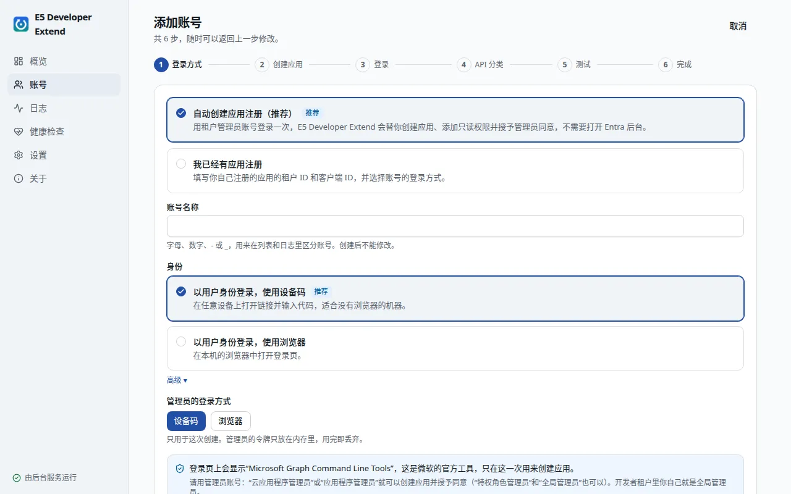

- **身份**：默认“以用户身份登录，使用设备码”，适合大多数人。“使用浏览器”会在本机浏览器里登录。
  点“高级”还能选**应用身份（Client Secret）**：不需要有人登录，直接读取某一个用户的数据，会创建一个 Client Secret 存进加密保险库，不会显示出来；这时要填被读取用户的邮箱。
- **管理员的登录方式**（“高级”里）：设备码或浏览器，只用于这一次创建应用，管理员的令牌只放在内存里，用完即丢。

点**下一步**。

### 用管理员账号登录一次

页面显示一段代码和一个链接：在任意浏览器打开链接，输入代码，用租户管理员账号登录并同意权限。
可以点**复制代码**、**打开浏览器**。登录页上会写着“Microsoft Graph Command Line Tools”，这是微软的官方工具，只在这一次用来创建应用。

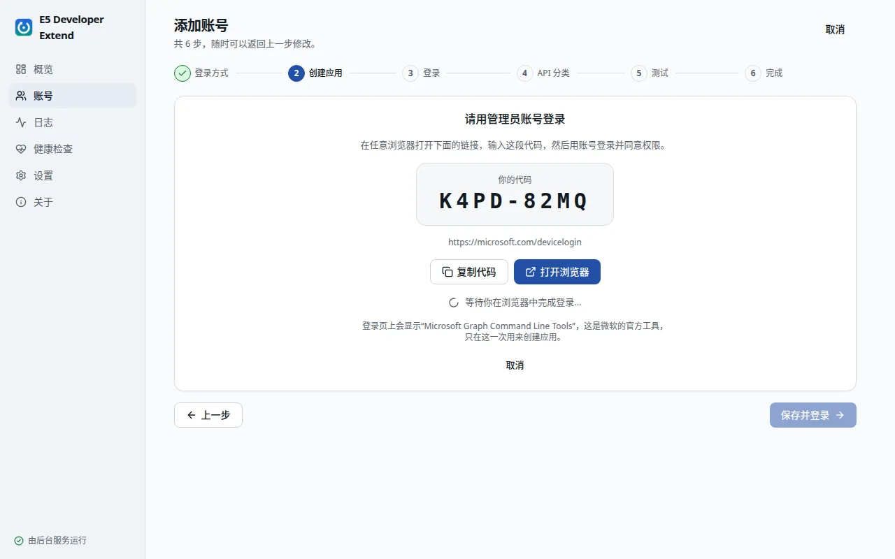

管理员需要有创建应用和授予同意的权限：“云应用程序管理员”或“应用程序管理员”可以创建应用并授予委托权限，“特权角色管理员”和“全局管理员”也可以。

### 确认计划

登录成功后，程序先看一遍租户里已经有什么，然后把**要做的事**列出来：应用名称、租户、要添加的只读权限，以及“将会发生什么”
（创建应用、创建服务主体、授予管理员同意……）。**确认之前什么都不会创建，已有的东西也不会被删除。**

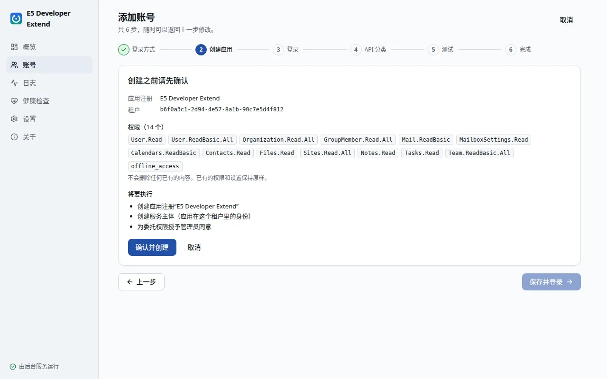

租户里如果已经有手工建的同名应用，这一页会让你选择**采用其中一个**还是**新建一个**。确认后点**确认并创建**。

### 创建过程和结果

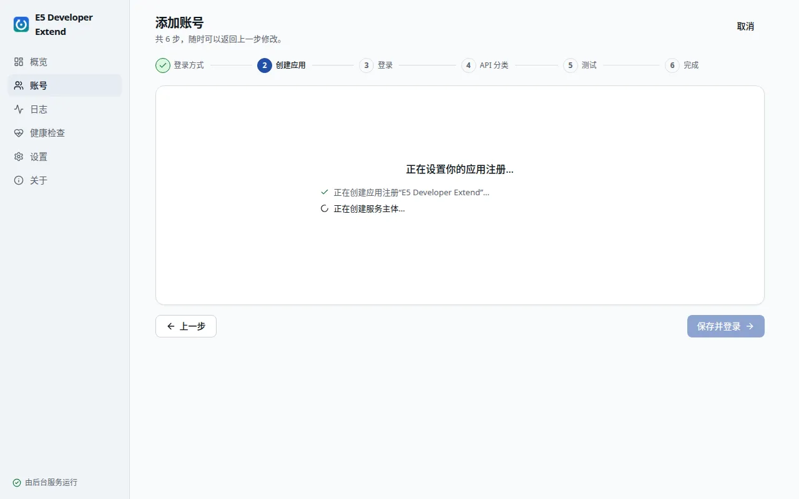

几秒钟后出现“应用注册已就绪”：显示客户端 ID、租户 ID，以及管理员同意已授予。点右下角的**保存并登录**。

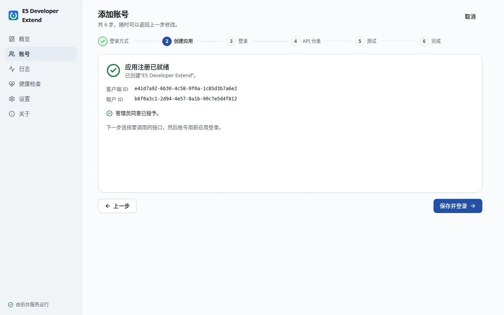

接着账号会用新建的应用登录一次（又是一段设备码，或者弹出浏览器）。刚创建的应用微软需要几秒钟才认得，程序会自动等待并重试。
看到“登录成功”后点**下一步**。

## 3. 选 API、测试

登录之后，程序检查这个账号实际能用什么：没有 Exchange 邮箱就不能读邮件，没有 OneDrive 就不能读文件……
每个分类都带标记：**推荐**（会勾选）、**不可用**（带原因，比如“缺少权限 Application.Read.All”）、**可能可用**（暂时确认不了）。
默认勾选推荐的，也可以自己改；“选择推荐的”一键恢复，“重新检查”再查一次。

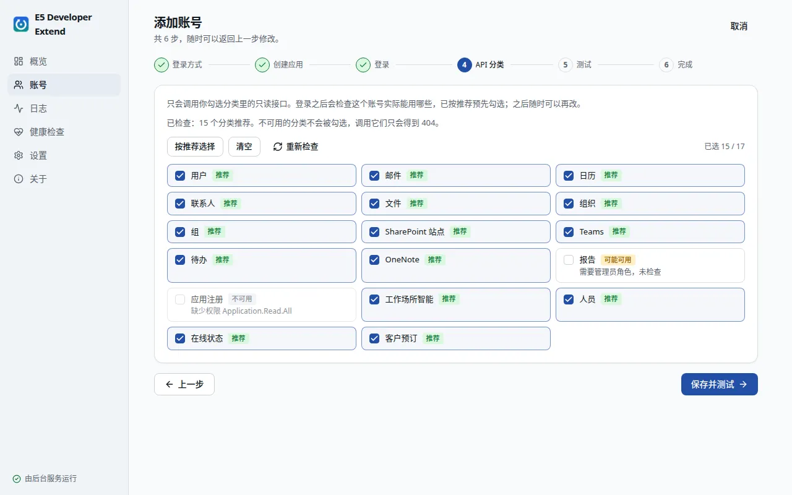

点**保存并测试**。测试页显示“N / M 个 API 可用”、已授予的权限和各分类的可用情况，点**下一步**，最后点**完成**。

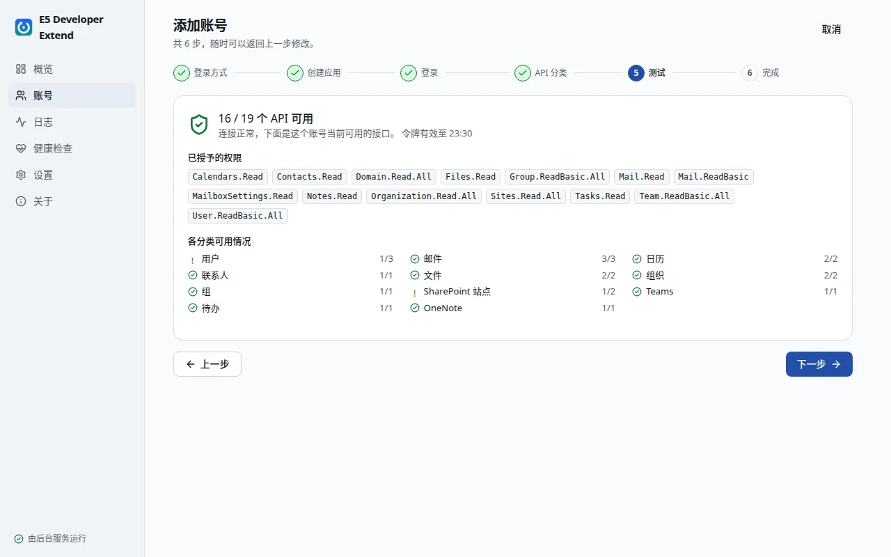

## 4. 看它是否在工作

**概览**页显示引擎状态、下次运行时间、今日调用次数，和每个账号的卡片。可以点**立即运行**马上跑一轮试试。
**账号**页是账号列表（暂停、编辑、重新登录、删除）；**日志**页是每次调用的记录。

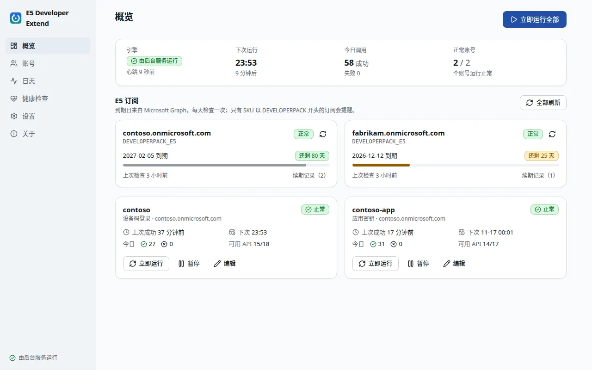

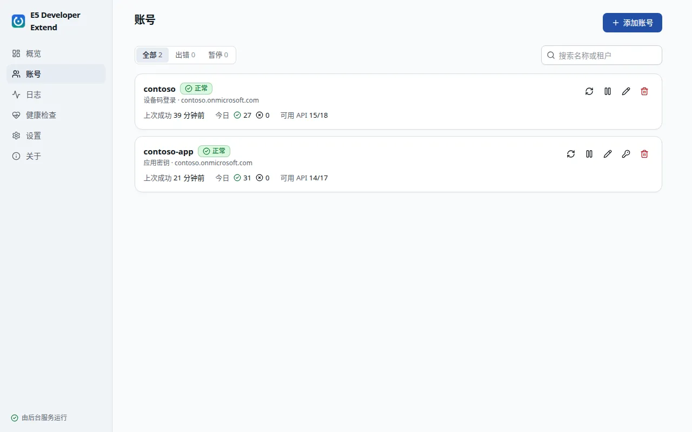

界面也有深色主题（设置 → 界面 → 主题）：

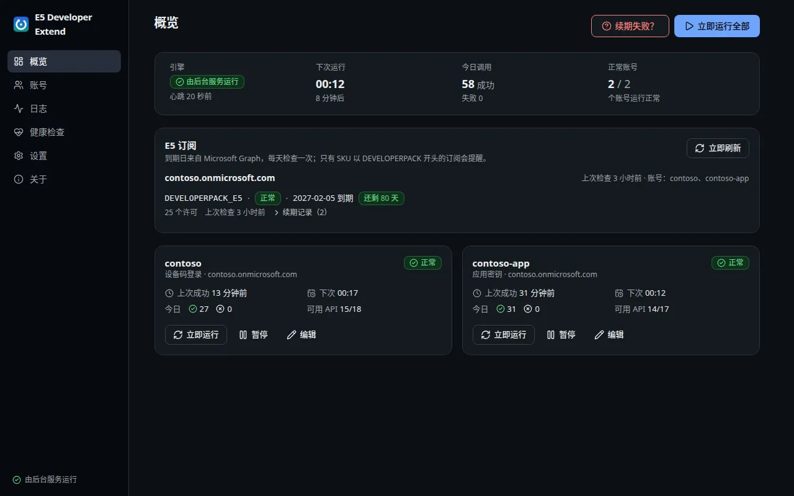

## 5. 让它一直在后台跑

打开**设置**。**运行方式**里有两个开关：

- **开机启动托盘**：登录桌面后启动托盘并运行引擎。
- **在后台保持运行**：安装后台服务（Linux 的 systemd 用户服务、macOS 的 LaunchAgent、Windows 的计划任务）。关闭窗口、退出托盘之后仍会继续调用，也不需要桌面。

打开后会显示“运行中”和下次运行时间。两者都有时由后台服务运行引擎，托盘只显示状态。

**调用节奏**有五档预设，以及每天还是只在工作日运行；精确的间隔、工作时段、运行期限、代理在“高级设置”里。默认全天、每天都调用。

| 预设 | 间隔 | 每轮 API 数 | 用途 |
| --- | --- | --- | --- |
| 轻度 | 2 到 4 小时 | 2 到 5 | 想少打扰 |
| **标准（默认）** | 40 分钟到 2 小时 | 3 到 8 | 日常使用 |
| 频繁 | 20 分钟到 1 小时 | 5 到 12 | 想更勤一点 |
| 密集（类似 Renew Plus） | 8 到 17 分钟 | 15 到 25 | 接近 Microsoft365 E5 Renew Plus 的强度 |
| 急救（临时） | 5 到 10 分钟 | 20 到 30 | 订阅快到期的最后几天；过后请改回“标准”，程序不会自动改回 |

某一轮要的 API 数比账号能用的多时，会把能用的全部调用一遍。强度越高越容易被限流，订阅是否续期仍由微软决定。

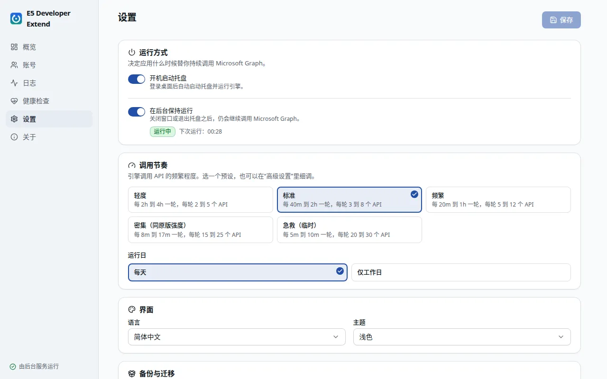

每个平台的细节见 [background.md](background.md)。

## 6. 设置告警（以 Telegram 为例）

出问题时（账号需要重新登录、连续失败、密钥快过期、订阅快到期……）推送到你的手机。

1. **设置 → 高级设置 → 告警**，点**添加渠道**。
2. 选类型 **Telegram**，起个渠道名（比如 `tg`），填 **Chat ID** 和 **Bot Token**（怎么取见 [notifications.md](notifications.md#telegram)）。Bot Token 保存后不会再显示。
3. 保存，然后点**发送测试**，手机上应该收到一条消息。**预览消息**可以先看消息长什么样。

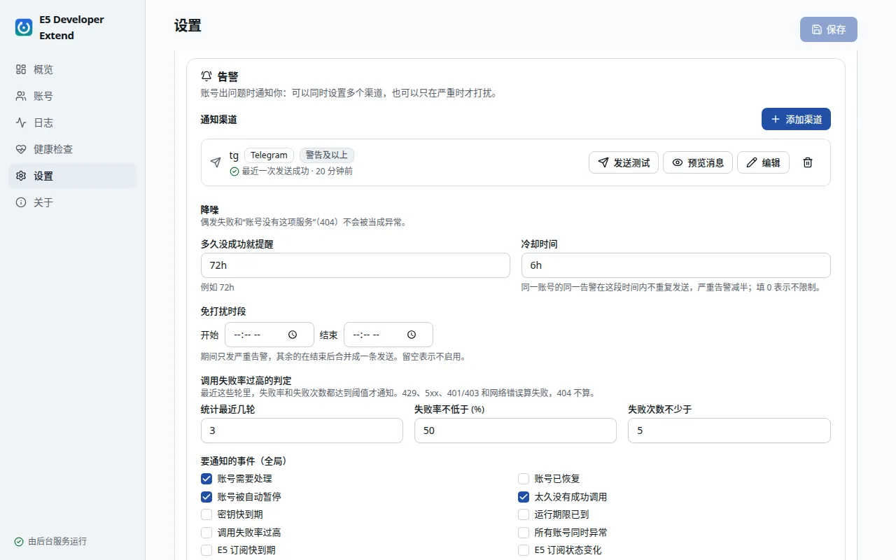

渠道有“最低级别”，页面下方还可以设置降噪（冷却时间、免打扰时段）和要告警的事件。邮件、企业微信、飞书、钉钉等其他渠道同理，见 [notifications.md](notifications.md)。

## 7. 备份与迁移

换电脑或重装系统前，在**设置 → 备份与迁移**导出一个文件：输入备份密码（至少 8 个字符，**忘了无法找回**）并再输一次，
选择是否包含调用记录，点**导出…**，选保存位置。账号、secret、登录状态、告警设置都在里面，用备份密码加密。

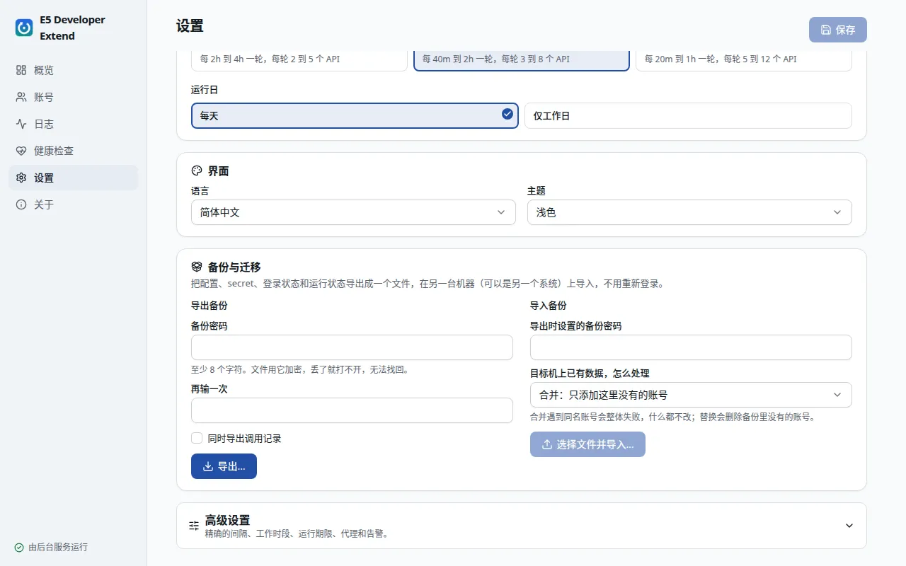

在新机器上同一位置输入密码，点**选择文件并导入…**；这台机器已有数据时可以选“合并”或“替换”。导入后不需要重新登录。详见 [backup.md](backup.md)。

## 看订阅什么时候到期

E5 开发者订阅到期前会有提醒，状态变化和续期也会通知你。引擎每天（启动并跑完第一轮之后）读一次租户的订阅信息
（`GET /directory/subscriptions`），同一租户的多个账号只读一次。

**概览**页的“E5 订阅”区：每个订阅一张小卡片，横着排成网格（窗口窄时一列，默认宽度两列，更宽三列）。卡片上是租户（域名）、SKU（如 `DEVELOPERPACK_E5`）、状态、到期日，以及带进度条的剩余天数（超过 30 天灰色，30 天内黄色，7 天内红色）；点**续期记录**在弹窗里看历史；卡片右上角的刷新图标只刷新这个租户，**全部刷新**会马上把所有租户再读一次。不在关注范围内的订阅（如 `FLOW_FREE`）没有卡片，点“另有 N 个订阅”可以看到它们。

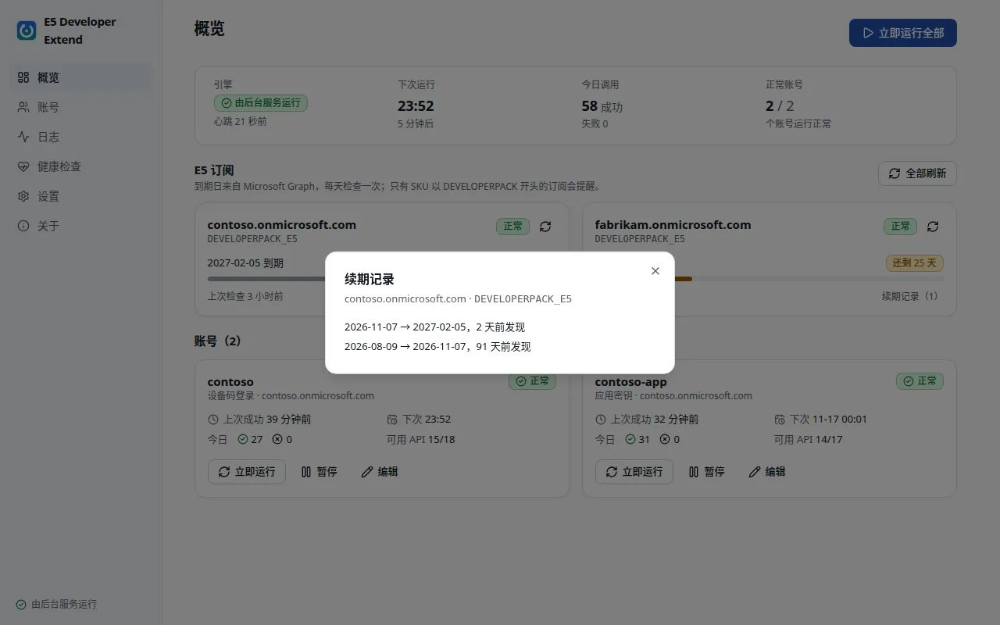

到期前 30、7、1 天会提醒（走你设置的告警渠道），状态变坏和续期也会通知。只有 SKU 以 `DEVELOPERPACK` 开头的订阅会提醒，
想关注别的 SKU 在 `config.toml` 里写 `[subscription] skus = ["DEVELOPERPACK", "ENTERPRISEPREMIUM"]`（每项按前缀匹配）。

**需要权限 `Organization.Read.All`**（委托和应用身份都是，需要管理员同意；用自动创建的应用已经包含它）。
没有这个权限时卡片会说明原因，不算错误也不告警（之后每小时再看一次）。补齐权限只是给账号**正在用的那个**应用注册加上缺的权限，不新建账号、不新建客户端密钥：

- 桌面版：卡片上的**补齐权限**，用租户管理员登录一次，只补缺的权限并授予同意；找不到该账号的应用注册、或租户里的应用与账号用的不是同一个时会拒绝，什么也不改；
- 命令行（任何账号）：`e5extend app setup --repair --account <账号>`，租户和应用都取自这个账号，只补缺的权限（Client Secret 账号是应用权限和角色分配），不新建账号，不生成也不删除 Secret；`--no-new-secret`（加 `--app-only`）是 Client Secret 账号的旧写法；`--repair` 不能和 `--tenant`、`--adopt`、`--new`、`--no-rename` 一起用；
- 或在 Entra 的“API 权限”里手动添加后授予管理员同意。

委托账号登录的用户还需要能读目录，开发者租户的管理员满足。补齐后点“全部刷新”（或运行 `e5extend subscription`）会向正在运行的引擎要一个新令牌再读。

暂时补不了权限时，可以手动填写到期日：租户卡片上的**手动填写到期日**，或 `e5extend subscription <账号> --set-expires 2027-02-14`
（配置里是 `subscription_expires = "2027-02-14"`，属于租户，写在该租户的任一账号上）。有手动日期时照常提醒；读到真实数据后以真实数据为准，并提示你可以删掉它。

到期日和剩余天数按本机时区显示。同一租户用不同写法（域名、租户 ID、`organizations`）配置的账号，在读到租户 ID 之后会合并成一个租户，只读一次。

这只是报告事实（日期、状态、续期记录）；微软没有公开“会不会续期”的判定，见 [常见问题](faq.md#会不会保证续期)。

## 体检

**健康检查**页逐项检查配置、保险库、引擎、后台服务、网络、时钟、每个账号的登录和权限，并给出修复建议。
“只做本地检查（不联网）”可以跳过联网项。出现警告或失败时，先看这一页，再看 [troubleshooting.md](troubleshooting.md) 和 [faq.md](faq.md)。

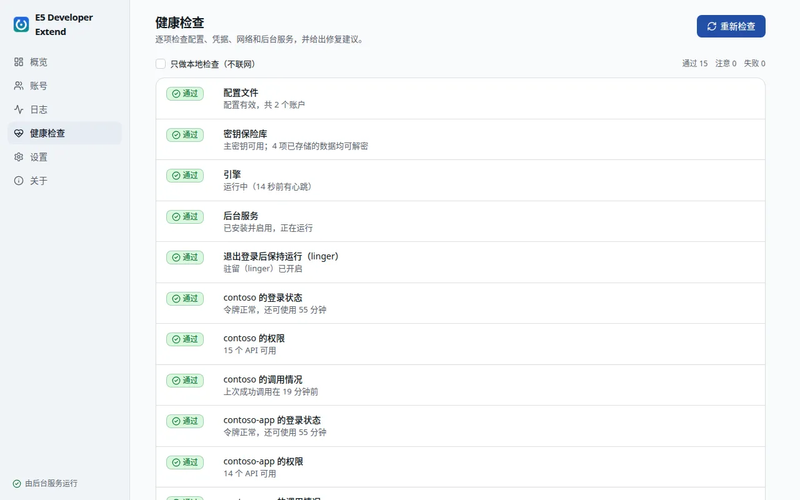

## 命令行和服务器

没有桌面的服务器、Docker，或者你就是喜欢命令行：桌面版的安装包已经把命令行程序一起装好了；
只用命令行时，把 `e5extend`（Windows 上还有不弹控制台窗口的 `e5extend-bg.exe`，两者放同一目录）放在一个固定的位置，
例如 `~/.local/bin/` 或 `C:\Users\你\bin\`。**不要放在临时目录或“下载”文件夹**，后台服务会拒绝安装。

### 最快的方式：向导

```bash
e5extend init
```

向导需要在交互式终端里运行，每一步都可以跳过，已经做完的步骤会自动跳过。它依次做：

1. 生成默认配置
2. 选择主密钥的保存方式（系统钥匙串；没有桌面的服务器选“生成密钥并显示”）
3. 添加账号（可以选“自动创建（推荐）”，或填已有应用的登录方式、租户、Client ID）
4. 登录
5. 静默取令牌并统计可用的 API 数量
6. 立即跑一轮
7. 设置 Webhook 告警（可跳过）
8. 安装后台服务
9. 运行 `e5extend doctor`

### 手动步骤

```bash
e5extend config init
e5extend account add main --auto --auth device_code    # 自动创建应用并添加账号；已有应用则用 --tenant 和 --client-id
e5extend account login main          # 按提示打开网址、输入设备码
e5extend account test main           # 静默取令牌，列出已授予的权限
e5extend run-now main                # 立即跑一轮，打印每个调用的结果
e5extend service install             # 安装后台服务，见 background.md
e5extend doctor                      # 体检
```

`account add` 的 `--auth` 可以是 `device_code`、`browser`、`client_secret`、`password`。
`client_secret` 和 `password` 会提示输入密钥（不回显），存进加密的 vault，配置文件里没有任何密钥。
已有应用时：`e5extend account add main --auth device_code --tenant organizations --client-id <你的应用 ID>`。

### 选对 API 分类

不是每个账号都有邮箱、OneDrive 或 Teams：没有 Exchange 邮箱的账号调邮件、日历、联系人、待办只会得到 404 / 400，每一轮都白白失败。
登录之后让 e5extend 查一下这个账号实际能用什么：

```bash
e5extend account test main --recommend            # 列出每个分类：recommended / unavailable / maybe，以及原因，并给出建议的 categories
e5extend account test main --recommend --apply    # 把推荐的分类写进账号（会先问你；--yes 跳过确认）
```

检查只发几个只读请求（邮箱设置、OneDrive、Teams、SharePoint 根站点），不会写入任何东西。
`maybe` 表示暂时确认不了（网络错误、需要管理员角色的报告）。`--apply` 不会因为 `maybe` 去掉账号已有的分类；只要有探测暂时失败，它会拒绝写入（稍后再试，或加 `--force`）。

如果建议的分类正好是默认的那一组，账号的 `categories` 会保持为空，以后新增的默认分类会自动生效；否则会写成明确的列表，
这种列表**不会**自动带上以后新增的分类，更新之后可以再运行一次 `--recommend --apply`。
运行一段时间后，如果某个分类连续 3 轮都是 404，`e5extend doctor` 会提醒你再检查一次。

### 订阅、状态和日志

```bash
e5extend subscription            # 立即读取并列出：SKU、状态、到期日、剩余天数、是否试用、续期记录
e5extend subscription --cached   # 不联网，只看引擎上次保存的结果
e5extend status        # 引擎是否在运行、每个账号的状态、下次运行时间
e5extend logs -n 20    # 最近的调用记录
e5extend doctor        # 全面检查，退出码 0 正常、1 有警告、2 有失败
```

### 告警和备份

```bash
e5extend notify channel add tg --type telegram --chat-id <你的 chat id>   # Telegram、邮件、企业微信、飞书等都可以
e5extend notify test
e5extend backup export all.e5backup          # 备份；在另一台机器上 backup import
```

各渠道怎么设置、怎么降噪见 [notifications.md](notifications.md)，备份见 [backup.md](backup.md)，Docker 见 [docker.md](docker.md)。
